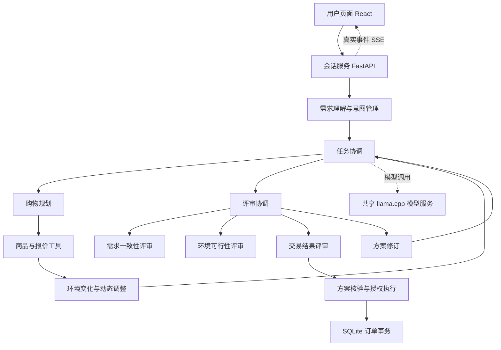

# ROCm AgentShop

**基于 TAPay 的中文购物智能体教学 Demo，在 AMD ROCm 环境部署 Qwen3 本地推理。**

ROCm-AgentShop connects natural-language shopping requests to a verifiable sandbox workflow. It uses a local language model for interpretation, planning and review, and deterministic application code for state, authorization checks and order transactions.

本项目来自 TAPay 的课程工程实践。用户说明需求后，系统查询商品、展示候选，核对当前意图和授权，并在自建商城生成沙盒订单。右侧协作图展示实际角色分派、嵌套调用和返回记录；没有运行的节点不会凭空出现。

## 可以演示什么

- 商品类别与模糊预算先进入查询和推荐；明确硬预算用于执行检查。
- 用户确认具体方案后记录商品选择及本轮授权。
- 修改颜色、数量或预算时保留其他仍有效的要求。
- 价格、库存、授权变化后重新查询和核验，提交层再检查当前状态。
- 一种商品每单 1–10 件、连续购物任务、取消、重复请求去重、SSE 重连。
- 对话、候选、订单和实际角色调用图。

商城包含 20 款虚构商品，以人民币计价；无真实支付、银行卡或外部商户连接。每个会话拥有独立的沙盒库存和钱包。

## 结构与职责



这是职责示意，运行顺序以实际事件为准；图包含修订返回，不表示严格 DAG 或所有角色并行运行。原 AgentTeam / TalkHier 层级流程由 LangGraph 执行，多个角色共享同一模型服务，并非分别训练多个模型。

## 快速运行

需要 Python 3.11/3.12、Node.js 22.6 及以上，以及支持工具调用的模型服务。Node 版本要求用于直接运行 TypeScript 图模型测试。

```bash
git clone https://github.com/iFinTech4X/ROCm-AgentShop.git
cd ROCm-AgentShop
python -m venv .venv
source .venv/bin/activate
python -m pip install -e '.[test]'
cp .env.example .env
cd frontend
npm ci
npm run build
cd ..
python -m uvicorn app.main:app --host 127.0.0.1 --port 8000
```

Windows 使用 `.venv\Scripts\activate` 和 `Copy-Item .env.example .env`。平台 Python 若缺少 `ensurepip`，可以使用 `uv venv .venv` 与 `uv pip install --python .venv/bin/python -e '.[test]'`。

浏览器打开 `http://127.0.0.1:8000`。默认模型地址是 `http://127.0.0.1:8081/v1`；未启动模型时页面会显示未就绪，不会用预设回答冒充模型。

AMD GPU 构建、模型准备与平台访问见 [AMD 部署说明](docs/amd-deployment.md)。模型权重从官方来源单独获取，不随仓库分发。`requirements-lock.txt` 保存课程运行依赖快照，跨平台安装优先使用 `pyproject.toml` 中的直接依赖范围。

## 五分钟演示

1. 输入“帮我买个耳机，价格230左右”，检查是否出现真实商品候选。
2. 选定某个候选，发送页面填入的确认文本，观察意图和授权更新。
3. 新任务输入“买一副白色听山 Air，含运费不超过320元，符合就下单”。
4. 在生成报价后、提交前，使用演示控制把 A01 价格改成 349 元，或把库存改为 0。
5. 查看实际重新核验、最终结果及订单记录。已完成订单不会被伪装成中途变化。

功能范围、已知问题及资源数据见 [验证与限制](docs/validation.md)。

## 验证

```bash
python -m pytest -q -p no:cacheprovider
python scripts/verify_source.py
cd frontend
npm test
npm run build
```

后端检查使用受控回复，不代表模型准确率。图模型测试使用真实测试轨迹提取的结构事件；提示、模型原文和原始会话标识均不在公共夹具中。

需要真实模型验证时，先启动模型和应用，再手动执行：

```bash
VALIDATION_BASE=http://127.0.0.1:8000 python scripts/validate_hierarchy.py my-validation
python scripts/audit_live_hierarchy.py artifacts/my-validation
```

该命令会进行真实推理并保留各次记录，消耗部署资源；默认测试和 CI 不运行它。审计脚本的使用参数以源码为准。

## 目录

| 路径 | 内容 |
|---|---|
| `app/` | 会话、商城、任务管理、意图适配和事务提交 |
| `frontend/` | React 页面和基于真实事件的协作图 |
| `vendor/rq2/` | 原 TAPay RQ2 代码副本及层级协作基础 |
| `vendor/SOURCE.json` | 原 49 份代码的 SHA256 校验记录 |
| `tests/` | 受控后端回归检查 |
| `scripts/` | 启动、源码校验和可选真实模型验证 |
| `docs/` | AMD 部署、验证边界和硬件体验 |

## 复用与许可

复用的层级协作基础来自 [Sony TalkHier](https://github.com/sony/talkhier)，原作者及变更说明见 [第三方声明](THIRD_PARTY_NOTICES.md)。本项目保留其 **CC BY-NC 4.0 非商业条款**，不将上游代码重新标为 MIT 或 Apache。新增课程工程代码同样按仓库的 CC BY-NC 4.0 条款提供，供符合许可的学习、研究和修改使用；它不是允许任意商业使用的许可。

Qwen3 模型、llama.cpp 及运行依赖分别遵循各自许可证。本仓库不代表 AMD、Sony 或 Qwen 官方产品，也不包含课程账号、API 密钥、用户数据库、私有实验结果或模型权重。
